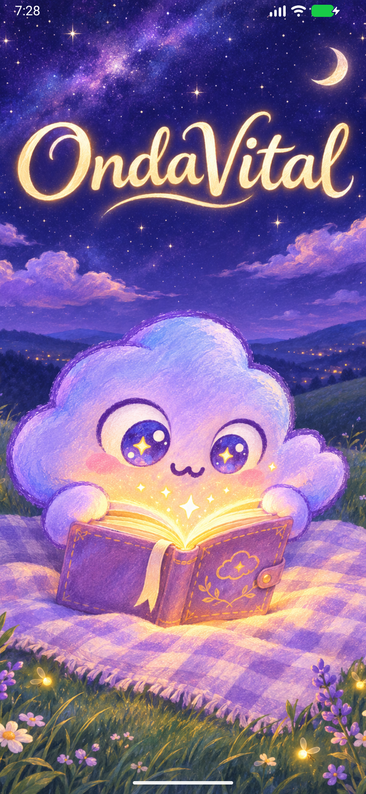
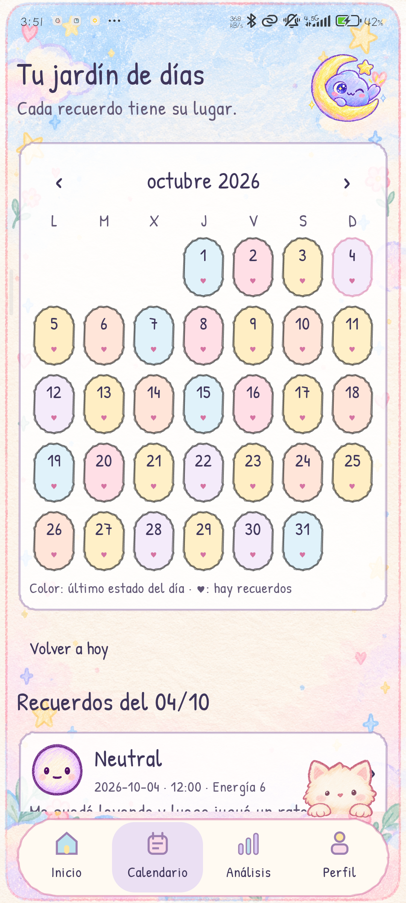
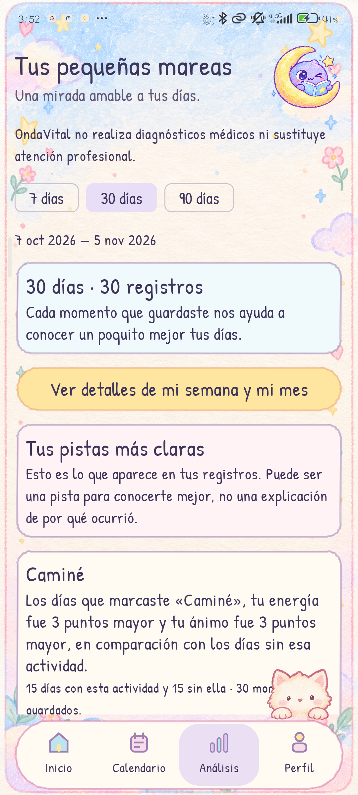
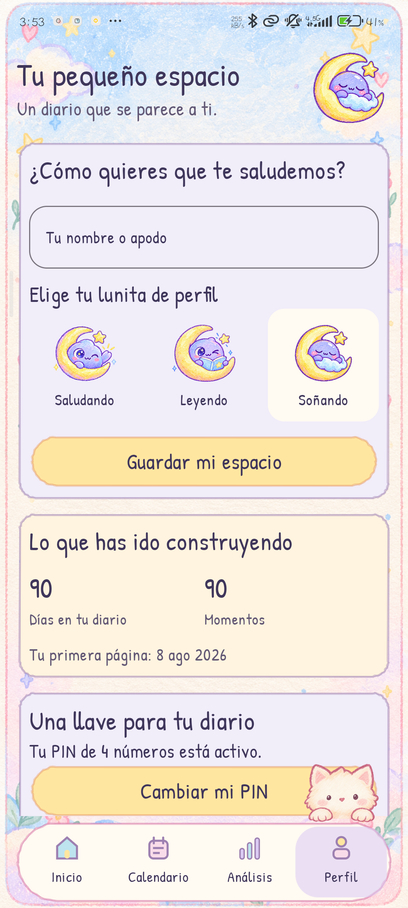

# OndaVital

**Daniel Alejandro Ramírez Hernández · André Michel Marín Espinoza**

[Descargar OndaVital para Android (APK)](https://github.com/amme140905-afk/OndaVital/releases/download/v1.0/OndaVital-1.0.apk)

**Un momento para ti.** Un diario emocional para Android que convierte tus recuerdos cotidianos en una forma sencilla de conocer cómo te sientes.

Registra tu ánimo, energía, actividades y pequeñas notas; vuelve a tus días desde un calendario de colores y descubre patrones con explicaciones cercanas. Su diseño combina papel, ilustraciones, tonos pastel y tinta violeta.

## Pantallas

| Bienvenida | Inicio | Calendario |
| :---: | :---: | :---: |
|  |  |  |

| Análisis | Perfil |
| :---: | :---: |
|  |  |

## Funciones

- **Diario personal:** ánimo en una escala de 1 a 8, energía de 1 a 10, actividades y notas. Permite guardar varios momentos en un mismo día.
- **Actividades personalizadas:** acompaña cada recuerdo con las actividades que forman parte de tu rutina.
- **Calendario emocional:** consulta tus recuerdos y reconoce el último estado de cada día por su color.
- **Análisis de 7, 30 y 90 días:** explora tendencias, distribución de estados y relación entre ánimo y energía.
- **Insights comprensibles:** descubre diferencias entre los días con una actividad y los días sin ella, con evidencia desplegable.
- **Reportes en PDF:** guarda resúmenes semanales y mensuales con gráficas y conclusiones.
- **Perfil y acceso:** configura un PIN y utiliza autenticación biométrica en dispositivos compatibles.
- **Control de tus datos:** exporta registros, perfil y actividades en JSON, o elimina los datos mediante confirmación.

La aplicación guarda los datos localmente en el dispositivo. Esta versión incluye un diario de demostración con 90 días de registros ficticios, actividades variadas y notas cotidianas.

## Cómo se obtienen los insights

El análisis agrupa los registros por fecha para que cada día tenga el mismo peso. Después compara el ánimo y la energía de los días con una actividad frente a los días sin ella.

Las tarjetas principales muestran hasta tres diferencias destacadas: requieren al menos 14 días registrados, un mínimo de 7 días en cada grupo y una diferencia de al menos un punto en ánimo o energía. La explicación «¿Por qué veo esto?» permite consultar los datos que respaldan cada tarjeta.

Las frases se generan mediante reglas y plantillas locales. Describen asociaciones observadas en el diario; por sí solas no demuestran que una actividad cause un cambio emocional.

## Tecnologías

- Kotlin y Jetpack Compose con Material 3.
- AndroidX Lifecycle, Activity, Fragment y BiometricPrompt.
- Persistencia local en JSON.
- Gráficas dibujadas con Compose y reportes con las API de PDF de Android.
- Gradle Wrapper y catálogo de versiones para administrar dependencias.

## Abrir y compilar

1. Clona el repositorio y abre la carpeta `OndaVital` en Android Studio.
2. Instala Android SDK 37 y configura un JDK compatible con el proyecto. El daemon de Gradle está configurado para Java 25.
3. Sincroniza Gradle y ejecuta la aplicación en un dispositivo o emulador con Android 7.0 (API 24) o posterior.

Para generar el APK de depuración en Windows:

```powershell
.\gradlew.bat assembleDebug
```

El archivo se genera en `app/build/outputs/apk/debug/app-debug.apk`.

## Estructura

```text
app/src/main/java/com/example/ondavital/
├── analisis/     Estadísticas, patrones y datos de demostración
├── data/         Persistencia, exportación y reportes PDF
├── model/        Modelos del diario
├── seguridad/    PIN, sesión y autenticación biométrica
└── ui/           Pantallas, componentes y tema visual
```

## Autores

- André Michel Marín Espinoza
- Daniel Alejandro Ramírez Hernández
